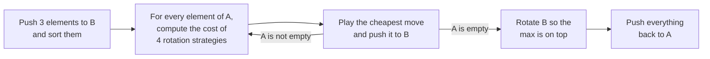

*This project has been created as part of the 42 curriculum by tfournie.*

<h1 align="center">🔢 push_swap</h1>

<p align="center">
  <b>Sort a stack of integers with two stacks, eleven operations, and as few moves as possible.</b>
</p>

<p align="center">
  
  
  
  
  
</p>

---

## 📖 The puzzle

You get a list of integers in stack **A** and an empty stack **B**. Using only the operations below, sort A in ascending order. The program prints the list of operations, and **the shorter the list, the better**.

| Operation | Effect |
|---|---|
| `sa` / `sb` / `ss` | Swap the first two elements of A / B / both |
| `pa` / `pb` | Push the top of B onto A / the top of A onto B |
| `ra` / `rb` / `rr` | Rotate A / B / both up: the first element becomes the last |
| `rra` / `rrb` / `rrr` | Rotate A / B / both down: the last element becomes the first |

There is no "look at index *i*" or "insert at position *i*": every move costs one operation, so the real problem is **choosing which element to move, and when**.

## 🧠 The algorithm

### Small inputs: hand-written solutions
- **2 numbers**: one `sa` if needed
- **3 numbers**: put the largest at the bottom, then swap if needed (at most 2 moves)
- **4 and 5 numbers**: push the smallest values to B, sort the remaining 3, push them back

### Large inputs: cost-based insertion



1. **Seed B**: push 3 elements to B and sort them in descending order.
2. **Compute costs**: for each element of A, find the position where it must go in B to keep B sorted. Bringing both to the top can be done 4 ways, and I compute the cost of each one:

   | Strategy | Moves used |
   |---|---|
   | A up, B up | `rr` for the shared part, then `ra` or `rb` |
   | A up, B down | `ra` + `rrb` |
   | A down, B up | `rra` + `rb` |
   | A down, B down | `rrr` for the shared part, then `rra` or `rrb` |

   Combining rotations with `rr` and `rrr` is where most of the moves are saved.
3. **Play the cheapest**: across all elements and all 4 strategies, pick the minimum, play it and `pb`.
4. **Finish**: once A is empty, B is sorted in descending order but rotated. Rotate it the short way until the maximum is on top, then `pa` everything back. A ends up sorted.

## 📊 Results

Measured on random inputs and validated with the official `checker_linux`, which printed `OK` on every run:

| Input size | Average moves | Worst seen | 42 target for full marks |
|---|---|---|---|
| 3 | 1 | 2 | ≤ 3 |
| 5 | 6 | 10 | ≤ 12 |
| 100 | **~578** | 620 | < 700 |
| 500 | **~5141** | 5269 | < 5500 |

## 🚀 Usage

```bash
make
./push_swap 2 1 3 6 5 8
```

```text
pb
pb
pb
...
```

Check the result with the checker:

```bash
ARG="$(shuf -i 1-1000 -n 100 | tr '\n' ' ')"
./push_swap $ARG | ./checker_linux $ARG     # OK
./push_swap $ARG | wc -l                    # number of moves
```

### Error handling
The program prints `Error` on stderr and stops for:
- non-numeric arguments (`./push_swap 1 abc`)
- values outside the `int` range (`./push_swap 2147483648`)
- duplicates (`./push_swap 1 1 2`)

An already sorted input prints nothing.

## 🗂️ Project structure

```text
push_swap.c            # entry point: check input, init stacks, sort
error_check.c          # number, range and duplicate checks
push_swap_inst_*.c     # the 11 operations (s, p, r, rr)
algo_hard.c            # dispatch by size, hand-written sorts for 2 to 5 numbers
ft_sort.c              # "is it already sorted?" check
algo_cost*.c           # cost of each element for the 4 rotation strategies
algo_find_cost.c       # find the cheapest element and strategy
algo_do.c              # play the chosen strategy
algo.c                 # main loop and final push back to A
libftok/, printfok/    # my own libft and ft_printf
```

## 📚 Resources

- [push_swap visualizer](https://github.com/o-reo/push_swap_visualizer)
